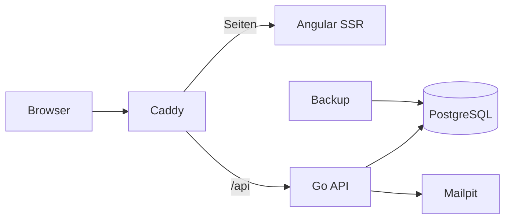

<p align="center"></p>

<h1 align="center">NordWinds</h1>

<p align="center"><strong>Deutschsprachige Shop-Vorschau mit Angular, Go und PostgreSQL</strong><br>Produktkatalog, Kundenkonto, Testkasse und Verwaltung in einem lokal startbaren Stack.</p>

[](https://github.com/mustafa-oezdemir/Nord_Wind/actions/workflows/ci.yml)
[](https://github.com/mustafa-oezdemir/Nord_Wind/actions/workflows/security.yml)


[](https://www.paypal.com/donate/?hosted_button_id=N39U7LWSRUA6E)

[Schnellstart](#schnellstart) · [Funktionen](#funktionen) · [Testbestellungen](#testbestellungen-simulieren) · [Tests](#qualität-prüfen) · [Betrieb](#betrieb-und-freigabe) · [Unterstützung](#projekt-unterstützen) · [Dokumentation](#dokumentation)

> [!IMPORTANT]
> NordWinds ist derzeit eine **lokale Vorschau**. Ein realer Betreiber, ein verbindliches Sortiment, ein echter Zahlungsanbieter sowie die rechtliche und steuerliche Freigabe fehlen. Es werden keine echten Zahlungen verarbeitet oder Waren versandt. Testbestellungen lassen sich ausschließlich in der lokalen Entwicklungsumgebung einschalten.

## Funktionen

| Bereich                 | Umgesetzt                                                                                                                                                                                        |
| ----------------------- | ------------------------------------------------------------------------------------------------------------------------------------------------------------------------------------------------ |
| Storefront              | Deutsche Produkt- und Kategorieseiten, Suche, Varianten, Preise in EUR, Versandhinweise und gezieltes Server-Rendering für öffentliche Seiten.                                                   |
| Kundenkonto             | Registrierung, Anmeldung, Profil, Adressbuch, Bestellhistorie und Bestelldetails auf Grundlage gespeicherter Auftragssnapshots.                                                                  |
| Warenkorb und Kasse     | Mengen, Rabattcodes, Bestandsprüfung, deutsche Lieferadresse, Versandkosten und ausdrücklich als Test gekennzeichneter Checkout.                                                                 |
| Testzahlung und Versand | Simulierte Zahlungsarten und Ereignisse, Bestellstatus, Sendungsnummer und Kundensicht auf den Versandstatus.                                                                                    |
| Verwaltung              | Katalog, Kategorien, Produkte, Rabattcodes, Bestellungen und ein Umsatz-Dashboard mit Zeit-, Kategorie-, Produkt- und Diagrammauswahl. Die Rolle `employee` ist auf den Bestellbereich begrenzt. |
| Betrieb                 | Versionierte Migrationen, JSON-Logs mit Request-ID, Metriken, tägliche Datenbanksicherung, Mailpit und optionale lokale Überwachung.                                                             |

Die Benutzeroberfläche verwendet Angular 22, TypeScript, Bootstrap und Chart.js. Die API basiert auf Go 1.27 und Gin; PostgreSQL 18 speichert Katalog, Konten und Bestellungen. Caddy verteilt Anfragen an Angular-SSR und API.



## Schnellstart

**Voraussetzungen:** Docker mit Compose-Plugin und PowerShell 7 (`pwsh`) für die Prüfskripte. Alle folgenden Befehle laufen im Repository-Stamm. Für einen vorhandenen lokalen Datenbestand die bestehende `.env` beibehalten.

```powershell
if (-not (Test-Path .env)) { Copy-Item .env.example .env }
# In .env mindestens POSTGRES_PASSWORD durch ein eigenes starkes Passwort ersetzen.
docker compose -f compose.yaml config --quiet
docker compose up -d --build
pwsh -NoProfile -File scripts/smoke.ps1
docker compose ps
```

| Adresse                              | Zweck                                   |
| ------------------------------------ | --------------------------------------- |
| `http://127.0.0.1:8080`              | NordWinds-Storefront und API über Caddy |
| `http://127.0.0.1:8025`              | Mailpit: lokal abgefangene E-Mails      |
| `http://127.0.0.1:8080/health/ready` | Bereitschaft der API und Datenbank      |

Der erste Start führt die Datenbankmigrationen aus. Ein neuer Datenbestand kann anschließend mit **wiederholbar einspielbaren Beispieldaten** gefüllt werden:

```powershell
Get-Content -Raw -Encoding UTF8 backend/seeds/demo_catalog.sql |
  docker compose exec -T db sh -c 'psql -U "$POSTGRES_USER" -d "$POSTGRES_DB" -X -v ON_ERROR_STOP=1'
```

`docker compose down` stoppt die Container und erhält die benannten Volumes. `docker compose down -v` würde Datenbank und Mailpit-Nachrichten entfernen und gehört nicht zum normalen Stopp. Die Host-Ports sind an `127.0.0.1` gebunden. `HOST_HTTP_PORT` und `HOST_MAILPIT_PORT` lassen sich in `.env` ändern; für den Smoke-Test dann `-BaseUrl` angeben.

### Testbestellungen simulieren

Die Vorlage `.env.example` hält die Kasse standardmäßig gesperrt. Für einen **lokalen Entwicklungsstack** in `.env` setzen:

```dotenv
APP_ENV=development
NORDWINDS_DEMO_CHECKOUT_ENABLED=true
```

Danach `docker compose up -d --no-build --no-deps --force-recreate api` ausführen. Unter `GET /api/v1/mock-payments/methods` sind dann die Testarten `debit_card`, `klarna`, `paypal` und `bank_transfer` abrufbar. Die Simulation nimmt keine Karten- oder Bankdaten an und verarbeitet kein Geld. Für die Testbestellung ist eine Kundenanmeldung und die Bestätigung des Vorschauhinweises erforderlich. Zahlungsereignisse können Erfolg, Fehlschlag und Erstattung nachstellen; Details stehen in [ADR-009](docs/adr/ADR-009-simulierte-zahlungen.md).

`APP_ENV=staging` und andere Umgebungen bleiben für Testbestellungen gesperrt; die lokale Staging-Konfiguration erzwingt `NORDWINDS_DEMO_CHECKOUT_ENABLED=false`. Dieser Schalter erteilt keine Freigabe für Live-Verkäufe.

## Qualität prüfen

Für Änderungen an Frontend oder Backend entsprechen diese lokalen Befehle den wesentlichen Schritten des [CI-Workflows](.github/workflows/ci.yml). Ohne Docker werden Node.js **26.13.0**, npm **12.2.0** und Go gemäß `backend/go.mod` benötigt.

```powershell
Push-Location frontend
npm ci
npm run format:check
npm run lint
npm run typecheck
npm test -- --watch=false
npm run build
npm audit --audit-level=high
Pop-Location

Push-Location backend
go vet ./...
go test ./...
Pop-Location

docker compose -f compose.yaml config --quiet
pwsh -NoProfile -File scripts/smoke.ps1
```

Die CI prüft darüber hinaus Go-Format, Go-Abhängigkeiten, Monitoring-Konfiguration und Docker-Builds. [Security](.github/workflows/security.yml) prüft Geheimnisse im Quellbaum und die Images. Die Workflow-Badges zeigen den **GitHub-Status**, nicht das Ergebnis eines lokalen Tests. [CI-Status und Einschränkungen](docs/verification/ci.md) trennen lokale Prüfergebnisse von den Remote-Checks.

## Betrieb und Freigabe

| Umgebung           | Zweck                                            | Bestellungen und Zahlungen                                                                  |
| ------------------ | ------------------------------------------------ | ------------------------------------------------------------------------------------------- |
| Lokale Entwicklung | Funktion und Testdaten prüfen                    | Nur bei `APP_ENV=development` und bewusst aktiviertem Demo-Schalter; vollständig simuliert. |
| Lokales Staging    | HTTPS, Migration, Restore und Kundenfluss prüfen | Checkout und Mock-Zahlungsroute gesperrt.                                                   |
| Produktion         | Noch nicht eingerichtet                          | Kein Live-Verkauf freigegeben.                                                              |

Mailpit fängt lokal Begrüßungs-, Sicherheits-, Bestell- und Versandnachrichten ab; SMTP bleibt im Compose-Netz. Das Postfach liegt im Volume `mailpit-data`, Zustellung an echte Postfächer findet nicht statt. Konfiguration und spätere Provider-Anbindung sind in [ADR-011](docs/adr/ADR-011-e-mail-benachrichtigungen.md) beschrieben.

Der Dienst `backup` erstellt beim Start und danach täglich ein geprüftes PostgreSQL-Archiv im Git-ignorierten Ordner `backups/`. [NW-24](docs/progress/NW-24.md) beschreibt Rücksicherung, Request-IDs, Metriken und ihre Grenzen. Mit `COMPOSE_PROFILES=monitoring` lassen sich Prometheus und Grafana lokal ergänzen; Einrichtung und Zugangsdaten stehen in [.env.example](.env.example) und der [Monitoring-Anleitung](docs/progress/monitoring.md).

Für die **isolierte lokale Staging-Vorschau** erklärt das [Release-Runbook](ops/release-runbook.md) `.env.staging`, `staging.localhost:18443`, synthetischen Kundenfluss, Backup- und Migrationsprobe. Das Zertifikat stammt von einer lokalen Caddy-CA. Ein echter Staging- oder Produktionsstart benötigt einen Betreiber, rechtliche/steuerliche Prüfung, einen Zahlungsanbieter mit Sandbox-Test, öffentliche Infrastruktur sowie durchgesetzte PR-, CI- und manuelle Freigaben. Die offenen Punkte sind in [NW-21](docs/progress/NW-21.md), [NW-25](docs/progress/NW-25.md) und [NW-26](docs/progress/NW-26.md) festgehalten.

## Projekt unterstützen

Die GitHub-Schaltfläche **Sponsor** nutzt den [PayPal-Donate-Link](https://www.paypal.com/donate/?hosted_button_id=N39U7LWSRUA6E) aus [`.github/FUNDING.yml`](.github/FUNDING.yml). Diese externe Unterstützung der Repository-Entwicklung ist keine Produktbestellung und aktiviert weder die NordWinds-Kasse noch einen Live-Verkauf.

[](https://www.paypal.com/donate/?hosted_button_id=N39U7LWSRUA6E)

## Dokumentation

| Thema                          | Einstieg                                                                                             |
| ------------------------------ | ---------------------------------------------------------------------------------------------------- |
| API-Vertrag                    | [OpenAPI](docs/api/openapi.yaml), [Backend-Anleitung](backend/README.md)                             |
| Frontend und Rendering         | [Frontend-Anleitung](frontend/README.md), [Zugänglichkeit und SEO](docs/progress/NW-22.md)           |
| Architekturentscheidungen      | [ADRs](docs/adr/), [Anforderungen und Backlog](docs/requirements/backlog.md)                         |
| Test- und Sicherheitsnachweise | [CI](docs/verification/ci.md), [Security](docs/progress/NW-23.md), [Betrieb](docs/progress/NW-24.md) |
| Versand und Kundenkonto        | [NW-19](docs/progress/NW-19.md), [NW-20](docs/progress/NW-20.md)                                     |

Lokale Umgebungsdateien, Datenbankarchive und Planungsentwürfe unter `_todo/` sind nicht Teil der veröffentlichten Projektdokumentation.
