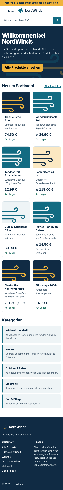
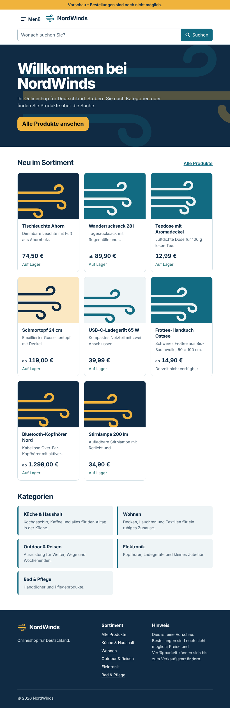
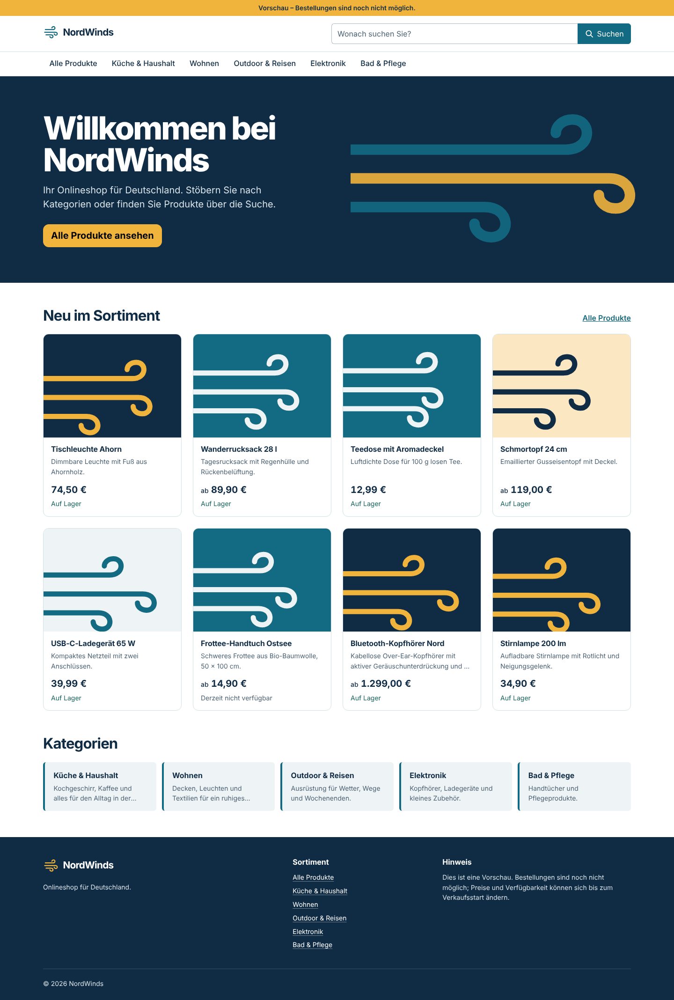

# NW-09 — Responsive NordWinds-Startseite und Design-System

- **Status:** Umgesetzt. Build, Typprüfung, Lint, Format, Specs und Browserprüfungen liefen in einer Linux-Ersatzumgebung (Einzelheiten unten). `npm test` mit Vitest, der GitHub-Actions-Lauf und eine Prüfung gegen den laufenden Compose-Stack stehen noch aus.
- **Basis:** `main` mit Stand `67334e4` (NW-04 bis NW-08a integriert). Anforderungen REQ-UI-01 und REQ-CAT-02 aus dem [Backlog](../requirements/backlog.md); API-Vertrag laut [OpenAPI](../api/openapi.yaml).

## Umsetzung

- **Routen:** `/` (Startseite), `/produkte` (alle Produkte, Suche), `/kategorien/:slug` (Kategorie inklusive Unterkategorien) und eine 404-Seite für unbekannte Adressen. Alle Seiten werden lazy geladen und haben Titel im Format „Seite | NordWinds“. Deutsche URL-Parameter: `q`, `sortierung` (`neu`, `name`, `preis-auf`, `preis-ab`) und `seite`. Ungültige Werte führen auf die Standardwerte, statt eine 400-Antwort der API auszulösen.
- **Datenzugriff:** `CatalogApi` ruft nur `GET /api/v1/products` und `GET /api/v1/categories` auf. Die Antworten werden vor der Anzeige geprüft: nur ganzzahlige Cent-Beträge, nur EUR, Pflichtfelder vorhanden. Abweichende Antworten erzeugen einen Fehlerzustand statt falscher Preise. Die Basis-URL kommt über `API_BASE_URL` (Standard `/api/v1`, derselbe Origin über Caddy). `ng serve` leitet `/api` per `proxy.conf.json` an `127.0.0.1:8080` weiter.
- **HTTP-Verhalten:** Ein funktionaler Interceptor gilt nur für API-Anfragen. Er handelt JSON aus, bricht nach 15 Sekunden ohne Antwort ab und wiederholt GET/HEAD bei Netzwerkfehler, 502, 503 oder 504 genau einmal. Schreibende Anfragen wiederholt er nie. Laufende Anfragen werden bei Parameterwechsel über `rxResource` abgebrochen. Fehler werden in deutsche Meldungen ohne Server-Details übersetzt.
- **Oberfläche:**
  - Kopfbereich mit Marke und Suche (`role="search"`, Label, 100-Zeichen-Limit wie die API).
  - Kategorienavigation ab 992 px; darunter ein mobiles Menü als natives modales `<dialog>` im Offcanvas-Stil, ohne Bootstrap-JavaScript. `closedby="any"` schließt es in unterstützenden Browsern zusätzlich per Klick auf den Hintergrund.
  - Startseite mit „Neu im Sortiment“ (8 Produkte) und Kategoriekacheln.
  - Produktliste mit Brotkrumen, Trefferzahl, Sortierung und Seitennavigation.
  - Produktkarte mit Ab-Preis bei mehreren Varianten und Bestandshinweis.
  - Ladeplatzhalter in Kartengröße, Leer- und Fehlerzustände mit konkretem Ausweg und Fußzeile.
- **Formatierung:** `de-DE` als `LOCALE_ID`, EUR als Standardwährung. Preise werden ausschließlich in Cent gerechnet und erst bei der Anzeige über `Intl.NumberFormat('de-DE')` formatiert (`1.299,99 €`).
- **Tastatur und Zugänglichkeit:**
  - Sprunglink „Zum Inhalt springen“.
  - Sichtbarer 3-px-Fokusrahmen; auf dunklem Grund in Bernstein.
  - Nach einem Seitenwechsel springt der Fokus an den Anfang des Inhalts, beim Blättern zur Überschrift.
  - Das Menü hält den Fokus, schließt mit Escape und gibt den Fokus an die Menü-Schaltfläche zurück.
  - `aria-current`, `aria-expanded` und `aria-busy` sind gesetzt. Bewegung (Windlinien, Menü, Platzhalter) entfällt bei `prefers-reduced-motion`.
- **Design-System:** Bootstrap 5.3 wird per Sass mit eigenen Variablen eingebunden, nur mit den genutzten Modulen. Das globale CSS sinkt dadurch von 231 kB auf 145 kB. Die Tokens stehen in `src/styles/_tokens.scss`:
  - **Farben:** Tiefsee `#102b44`, Fjord `#126b82`, Schiefer `#4c6172`, Nebel `#eef4f6` und Bernstein `#f0b33c`.
  - **Typografie:** Skala 1,25.
  - **Radien:** nach Hierarchie gestuft.
  - **Kontraste:** Fjord und Schiefer auf Weiß 6,1:1 und 6,4:1, Text auf Bernstein 7,7:1.
  - **Schrift:** Nur Systemschriften, damit keine Anfragen an Drittanbieter entstehen.
  - **Platzhalter:** Da Produktbilder erst mit NW-13 kommen, zeigt jede Karte ein aus dem Slug abgeleitetes Windlinien-Motiv aus dem Markenzeichen. Das Motiv ist dekorativ und für Screenreader ausgeblendet.
- **Konfiguration:** `strict` und `strictTemplates` sind aktiviert.

## Prüfungen

Die Angular-Toolchain läuft auf dem Windows-Rechner, aber nicht nativ unter Linux: Im Paketcache fehlen die Linux-Binärdateien von esbuild, rolldown, lightningcss und sass-embedded. Für die Prüfung wurde `node_modules` in eine Linux-Umgebung übertragen und um das identische esbuild 0.28.2 für Linux ergänzt. Der Build lief dort mit `NG_BUILD_BABEL_LINKER=1`, `NG_BUILD_SASS_EMBEDDED=0`, `NG_BUILD_OPTIMIZE_CHUNKS=0` und WASI für oxc. Die Chunk-Optimierung des Release-Builds lief deshalb nicht.

| Prüfung | Ergebnis |
| --- | --- |
| `ng build` (production) | **PASS**, keine Warnungen. Initial 440,6 kB roh bzw. 97,6 kB übertragen; Budget-Warnung erst ab 500 kB. |
| `tsc --noEmit -p tsconfig.app.json` und `-p tsconfig.spec.json` | **PASS** |
| Specs im Ersatz-Runner, Chromium (Playwright 1.63) | **PASS**, 51 von 51 |
| Specs im Ersatz-Runner, jsdom 30.1.3 (ohne `showModal`, prüft den Fallback) | **PASS**, 51 von 51 |
| `npm test` (Vitest über `@angular/build:unit-test`) | **NICHT AUSGEFÜHRT**, rolldown-Binary für Linux fehlt; auf Windows oder in CI nachholen |
| Tastaturprüfung im Browser, 17 Schritte | **PASS** (Sprunglink, Reihenfolge, Fokusrahmen, Suche per Enter, Fokus nach Seitenwechsel, Sortierung, Produktkarte, Menü mit Escape und Fokusrückgabe) |
| Screenshots Telefon (390 px), Tablet (820 px) und Desktop (1440 px) | **PASS**, ohne Konsolenfehler; siehe unten |
| `npm run format:check` (Prettier 3.9.10) | **PASS** |
| `ng lint` (angular-eslint 22.6.0, inklusive Template-Barrierefreiheitsregeln) | **PASS** |
| `npm audit --audit-level=high` | **NICHT AUSGEFÜHRT**, kein Zugriff auf die npm-Registry; keine neuen Abhängigkeiten |
| Automatische Barrierefreiheitsprüfung (axe o. ä.) | **NICHT AUSGEFÜHRT**, Kontraste wurden rechnerisch geprüft |
| Ende-zu-Ende gegen die echte Go-API im Compose-Stack | **NICHT AUSGEFÜHRT**, keine Docker- oder Go-1.27-Laufzeit in der Prüfumgebung |

Der Ersatz-Runner führt die unveränderten `*.spec.ts`-Dateien aus. Sie werden mit dem Angular-Application-Builder gebaut und laufen unter einer kleinen `describe`/`it`/`expect`-Laufzeit. Das ersetzt den Vitest-Lauf nicht. Zwei Fehler wurden dabei gefunden und behoben:

- Das Zeitlimit des Interceptors hätte mit `timeout({ first })` nie gegriffen, weil das Backend sofort ein Sent-Ereignis meldet.
- Die 404-Seite hätte eine leere Überschrift gezeigt, weil `withComponentInputBinding()` fehlende Parameter als `undefined` an Inputs übergibt.

Screenshots und Tastaturprüfung verwenden einen lokalen Mock der Katalog-API nach `docs/api/openapi.yaml` mit Beispieldaten. Die Bilder zeigen also das Verhalten gegen den Vertrag, nicht gegen echte Shopdaten. Die Schriftdarstellung hängt vom Betriebssystem ab.

| Telefon | Tablet | Desktop |
| --- | --- | --- |
|  |  |  |

Weitere Ansichten: [Kategorie mit Sortierung](nw-09/kategorie-desktop.png), [mobiles Menü](nw-09/menue-telefon.png), [Fehlerzustand](nw-09/fehler-telefon.png).

## Nachzuholen

```powershell
cd frontend
npm ci
npm run typecheck
npm test -- --watch=false
npm run build
cd ..
docker compose up --build -d
# http://127.0.0.1:8080 öffnen: ohne Katalogdaten erscheint der Leerzustand „Noch keine Produkte im Sortiment“
```

## Offene Punkte und Grenzen

- **Preisangaben:** Ob `price_cents` brutto oder netto ist, entscheidet NW-15. Deshalb zeigt die Oberfläche noch keinen Zusatz „inkl. MwSt., zzgl. Versand“, sondern einen Vorschauhinweis. Ohne diese Angaben und ohne die rechtlichen Seiten (NW-21) darf der Shop nicht verkaufen.
- **Kategorien:** Die Navigation lädt höchstens 100 Kategorien (Limit der API).
- **Suche:** Die Suche startet bewusst erst per Enter; eine Live-Suche mit Debounce folgt bei Bedarf.
- **Nicht enthalten:** Bootstrap Icons und Playwright-E2E-Tests sind nicht als Abhängigkeit eingebunden, weil in dieser Umgebung kein npm-Registry-Zugriff besteht. Die drei Symbole sind deshalb eigene Inline-SVGs.
- **Produktdetail:** `/produkte/:slug` zeigt bis NW-10 die 404-Seite.
