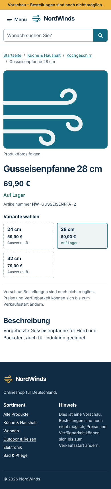
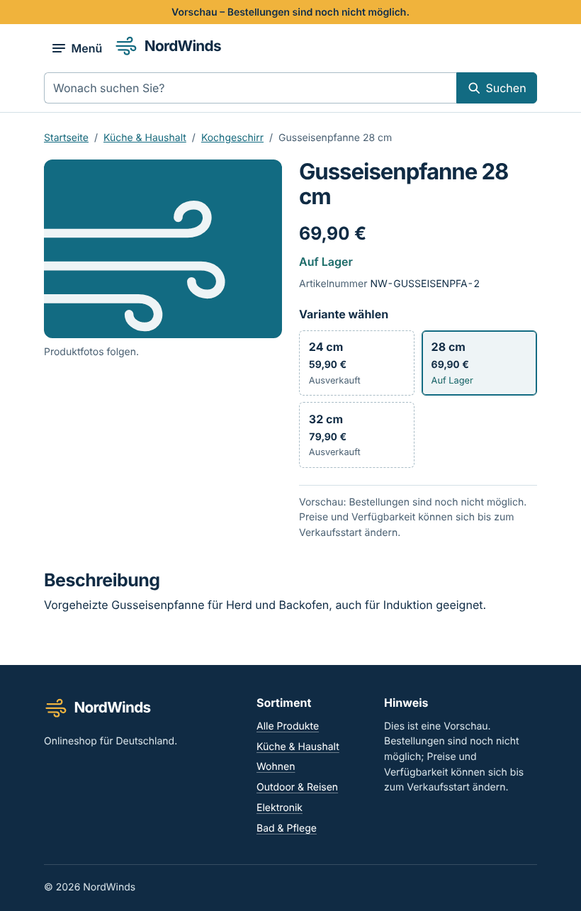
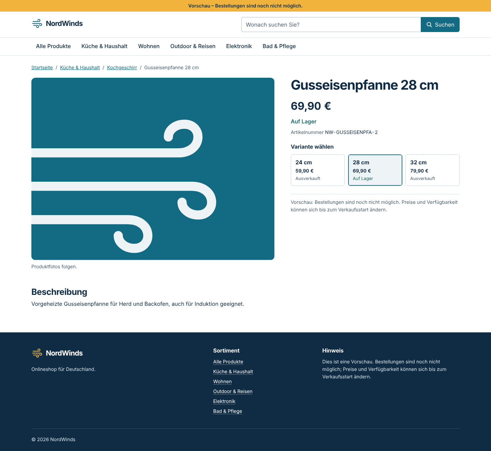

# NW-10 — Produktdetail und Variantenauswahl

- **Status:** Umgesetzt und geprüft. Die Oberfläche ist wie in NW-09 geprüft. Das Backend wurde mit Go 1.27.3 gebaut und gegen PostgreSQL 16.15 getestet (Projekt nutzt 18.6). Offen sind `npm test` mit Vitest, der GitHub-Actions-Lauf und ein PostgreSQL-18-Lauf.
- **Basis:** `main` mit NW-09 (`29730ab`). Anforderungen REQ-UI-01 und REQ-CAT-02.

## API: `GET /api/v1/products/{slug}`

- **Fund:** Die Katalog-API aus NW-08 hatte keinen Detail-Endpunkt. Ohne ihn hätten Preis und Bestand je Variante nicht aus dem Backend kommen können. Er ist deshalb Teil dieses Schritts und im [OpenAPI-Vertrag](../api/openapi.yaml) beschrieben.
- **Sichtbarkeit:** Veröffentlichte und archivierte Produkte werden geliefert; Entwürfe ergeben 404. Der Slug wird wie beim Unique-Index ohne Beachtung der Großschreibung verglichen; der Abfrageplan nutzt `products_slug_ci_unique`.
- **Varianten:** Nur aktive Varianten, sortiert nach Preis, Bezeichnung und ID. Die Reihenfolge ist auch dann stabil, wenn mehrere Varianten in einer Transaktion angelegt wurden (gleiches `created_at`). Archivierte Produkte liefern keine Varianten.
- **Bestand:** Exakte Lagermengen werden nicht veröffentlicht, sondern nur `stock_status`: `in_stock`, `low_stock` (höchstens 5 Stück) und `out_of_stock`.
- **Verkaufsstatus:** `sale_status` fasst Produktstatus und Varianten zusammen:

  | Wert | Bedeutung |
  | --- | --- |
  | `available` | mindestens eine Variante hat Bestand |
  | `sold_out` | aktive Varianten, aber ohne Bestand |
  | `unavailable` | veröffentlicht, aber ohne aktive Variante |
  | `discontinued` | archiviert |

- **Kategorien:** Nur aktive Kategorien des Produkts, in Pflegereihenfolge.
- **Eingaben und Fehler:**
  - Query-Parameter, ein leerer Slug, NUL-Zeichen und Slugs mit mehr als 120 Zeichen ergeben 400.
  - Fehler werden als RFC-9457-Problem-Antworten mit Request-ID ausgegeben, ohne Datenbankdetails.
- **Code:**
  - `internal/catalog/detail.go`: Abfragen und Statuslogik, nur Standardbibliothek.
  - `internal/server/catalog_detail.go`: Gin-Handler mit eigenem Antwort-DTO.
  - Neue Tests: `detail_test.go` und `catalog_detail_integration_test.go`.

## Oberfläche

- **Route:** `/produkte/:slug`, lazy geladen. Ladeplatzhalter, 404-Ansicht „Produkt nicht gefunden“, Fehlerzustand mit neuem Versuch. Der Seitentitel ist der Produktname; die Meta-Beschreibung kommt aus der Produktbeschreibung (höchstens 160 Zeichen).
- **Brotkrumen:** Zeigen den Pfad der ersten aktiven Kategorie, z. B. Startseite / Küche & Haushalt / Kochgeschirr / Produkt.
- **Galerie:** Vorschaubilder als benannte Schaltflächen mit `aria-pressed`. Die API liefert noch keine Bilder (folgt mit NW-13). Bis dahin zeigt die Galerie das Windlinien-Motiv mit dem Hinweis „Produktfotos folgen.“
- **Preis und Bestand:** Preis, Bestand und Artikelnummer gehören immer zur gewählten Variante. Der Preis kommt in Cent aus der API und wird nur formatiert; die Oberfläche rechnet nichts. Ein Preiswechsel wird über `aria-live` angesagt.
- **Variantenauswahl:**
  - Native Radiogruppe mit Legende „Variante wählen“. Pfeiltasten wechseln die Auswahl.
  - Jede Option nennt Bezeichnung, Preis und Bestand. Unsichtbare Kommas trennen die Teile im zugänglichen Namen.
  - Ausverkaufte Varianten bleiben wählbar, damit Preis und Status sichtbar sind.
  - Vorauswahl über `?variante=SKU` (Groß-/Kleinschreibung egal), sonst die erste lieferbare Variante.
  - Die Auswahl wird per `Location.replaceState` in die URL geschrieben: ohne neue Navigation, ohne Sprung nach oben und ohne Einträge im Verlauf.
- **Nicht im Verkauf:**
  - `sold_out` zeigt einen Hinweis und weiterhin die Preise.
  - `unavailable` und `discontinued` zeigen keinen Preis, sondern einen Link „Weitere Produkte in …“ (sonst „Alle Produkte ansehen“).
  - Einen Warenkorb-Button gibt es erst mit NW-14; bis dahin steht ein Vorschauhinweis an seiner Stelle.

## Prüfungen

Die Oberfläche lief in derselben Linux-Ersatzumgebung wie in [NW-09](NW-09.md) beschrieben.

| Prüfung | Ergebnis |
| --- | --- |
| `ng build` (production) | **PASS**; Initial 443,7 kB, Produktdetail als eigener Lazy-Chunk mit 14,1 kB |
| `tsc` (App und Specs), `ng lint`, `npm run format:check` | **PASS** |
| Specs im Ersatz-Runner, Chromium und jsdom 30.1.3 | **PASS**, jeweils 66 von 66 (15 neue für NW-10) |
| Browserprüfung NW-10, 20 Schritte | **PASS** (siehe unten) |
| Tastaturprüfung aus NW-09, 17 Schritte, erneut | **PASS** |
| SQL der drei Detailabfragen gegen PostgreSQL 16.15 mit den Migrationen 1–3 (Projekt nutzt 18.6) | **PASS**, inklusive Indexnutzung |
| `gofmt -l`, `go mod verify`, `go build ./...`, `go vet ./...` (Go 1.27.3) | **PASS** |
| `go test ./... -count=1` mit vier getrennten Datenbanken `nordwinds_test_*` (PostgreSQL 16.15) | `internal/server` (mit den neuen Detail-Tests), `internal/migrations` und `internal/database` **PASS**; `internal/catalog` **FAIL** in einem bestehenden, unveränderten Test, siehe unten |
| `go test -race ./internal/server/` | **PASS** |
| `npm test` (Vitest) | **NICHT AUSGEFÜHRT**, wie NW-09 |
| `govulncheck ./...` | **NICHT AUSGEFÜHRT**, keine Verbindung zur Schwachstellen-Datenbank; neue Abhängigkeiten gibt es nicht |

**Browserprüfung im Detail:**

- keine horizontale Scrollleiste auf Telefon, Tablet und Desktop;
- auf dem Telefon steht die Galerie über der Kaufbox, Variantenfelder sind mindestens 44 px hoch;
- Vorauswahl der ersten lieferbaren Variante;
- Pfeiltaste wechselt Variante, Preis und Bestand; URL-Parameter gesetzt, kein Sprung, Fokus bleibt;
- Neuladen behält die Variante;
- Produktkarte öffnet das Detail, Fokus liegt danach am Inhaltsanfang;
- Titel und Brotkrumen stimmen;
- Ausverkauft-, Eingestellt- und 404-Zustand sind korrekt;
- keine Laufzeitfehler.

**Go-Umgebung:** Go 1.27.3 wurde aus dem Toolchain-Modul im lokalen Modul-Cache für Linux gebaut, mit Go 1.24.7 als Bootstrap. Die Abhängigkeiten kamen offline aus dem lokalen Modul-Cache und wurden gegen `go.sum` geprüft.

**Bestehender Testfehler unter PostgreSQL 16:** `TestRepositoryPostgres/Datenbankfehler/Referenzierte_Kategorie_nicht_löschbar` (NW-07) erwartet beim Löschen einer referenzierten Kategorie den SQLSTATE `23001`. PostgreSQL 16 meldet für dieselbe `ON DELETE RESTRICT`-Verletzung `23503`. Der Test ist durch NW-10 unverändert, und der NW-07-Lauf mit PostgreSQL 18 bestand. Die Abweichung liegt also an der PostgreSQL-Version. Entweder prüft der Test künftig beide Codes, oder CI testet ausdrücklich gegen PostgreSQL 18.

**Behoben am 31. Oktober 2026:** Ursache ist PostgreSQL-Commit 086c84b23. Seit Version 18 meldet ein Fremdschlüssel mit `ON DELETE RESTRICT` den SQLSTATE `23001` (`restrict_violation`), bis Version 17 `23503` (`foreign_key_violation`). Der Test akzeptiert jetzt beide Codes (`restrictViolation` in `repository_integration_test.go`). Die Admin-API behandelte beide bereits als 409. Ein neuer Unittest (`admin_error_test.go`) sichert das für beide Versionen ab. `go test ./...` besteht damit auch unter PostgreSQL 16.

## Ansichten

Alle Screenshots verwenden den Vertrags-Mock aus NW-09.

| Telefon | Tablet | Desktop |
| --- | --- | --- |
|  |  |  |

Weitere Zustände: [ausverkauft](nw-10/ausverkauft-desktop.png), [nicht mehr angeboten](nw-10/eingestellt-desktop.png), [unbekannter Slug](nw-10/nicht-gefunden-desktop.png).

## Offene Punkte

- Produktbilder und ihr API-Feld folgen mit NW-13. Erst dann lohnt `NgOptimizedImage` mit festen Bildgrößen.
- Die Schwelle „knapp“ (5 Stück) ist eine Annahme; der Projektinhaber kann sie anpassen.
- Ob archivierte Produkte dauerhaft erreichbar bleiben oder später 410 liefern sollen, wird mit SEO (NW-22) entschieden.
- Canonical-URL, strukturierte Produktdaten und SSR gehören zu NW-22.
