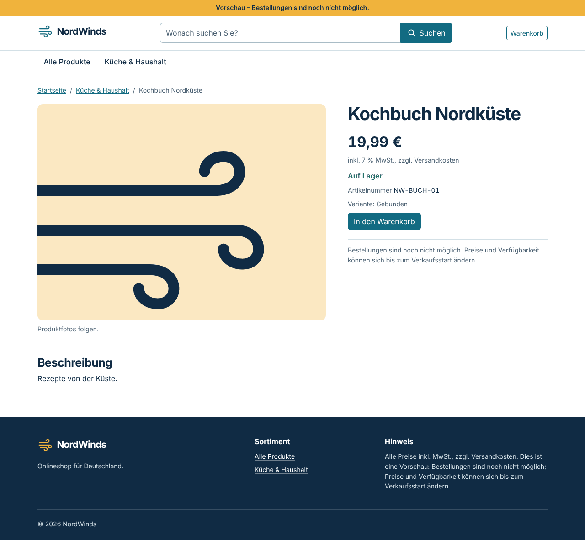
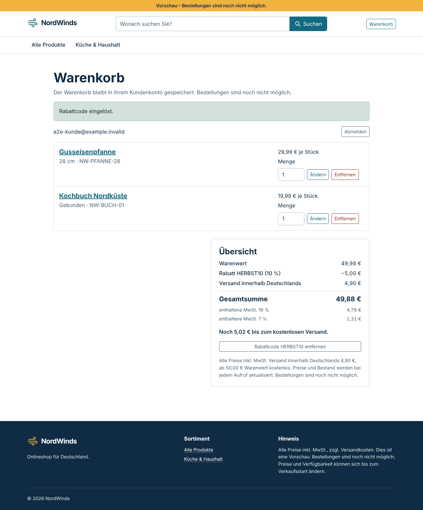
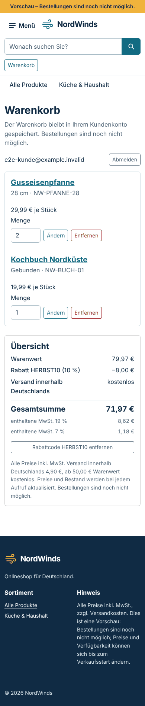

# NW-15 — Preis-, Steuer- und Versandvertrag

- **Status:** Umgesetzt und geprüft. Das Backend wurde mit Go 1.27.3 gegen PostgreSQL 16.15 getestet (das Projekt nutzt 18.6); die Oberfläche lief in derselben Linux-Ersatzumgebung wie in [NW-09](NW-09.md). Offen sind `npm test` mit Vitest, der GitHub-Actions-Lauf, ein PostgreSQL-18-Lauf und die steuerliche Prüfung vor NW-21.
- **Basis:** `main` mit NW-14, Beispielkatalog und Passwortgenerator (`bbb533b`). Anforderungen REQ-MONEY-01, REQ-ORDER-01 und REQ-DE-01.
- **Entscheidung:** [ADR-007](../adr/ADR-007-pricing-policy.md). Der Projektinhaber hat am 30. Oktober 2026 festgelegt:
  - Preise sind Bruttopreise inklusive Umsatzsteuer.
  - 19 % und 7 % je Produkt.
  - Versand 4,90 €, kostenlos ab 50,00 €.
  - Prozentualer Rabattcode auf den Warenkorb.

## Rechenregel

`backend/internal/pricing` ist eine reine Go-Funktion ohne Datenbank (`pricing.Calculate`). Warenkorb und später der Checkout rufen sie auf; die Oberfläche rechnet nicht selbst.

1. Positionssumme = Bruttostückpreis × Menge in Cent. Nicht lieferbare Positionen zählen nicht.
2. Rabatt = Warenwert × Prozentsatz, kaufmännisch gerundet. Er wird nach Warenwert auf die Steuersätze verteilt, mit dem Verfahren des größten Rests.
3. Versand 4,90 €, wenn der Warenwert nach Rabatt unter 50,00 € liegt. Er wird anteilig auf die Steuersätze verteilt (Nebenleistung).
4. Umsatzsteuer je Satz = Brutto × Satz ÷ (100 % + Satz), kaufmännisch gerundet; Netto = Brutto − Umsatzsteuer.
5. Gesamtsumme = Warenwert − Rabatt + Versand = Summe der Steuerzeilen.

Beispiel aus der Ende-zu-Ende-Prüfung: Pfanne 29,99 € (19 %) und Kochbuch 19,99 € (7 %) mit 10 % Rabatt:

| Schritt | 19 % | 7 % | Summe |
| --- | ---: | ---: | ---: |
| Warenwert | 29,99 € | 19,99 € | 49,98 € |
| Rabatt (4,998 € → 5,00 €) | −3,00 € | −2,00 € | −5,00 € |
| Versand (44,98 € < 50 €) | 2,94 € | 1,96 € | 4,90 € |
| Brutto | 29,93 € | 19,95 € | **49,88 €** |
| enthaltene MwSt. | 4,78 € | 1,31 € | 6,09 € |

## API

- **Produkt:**
  - `products.tax_class` (`standard` oder `reduced`, Standard `standard`) aus Migration 8.
  - Admins setzen die Klasse über `POST /api/v1/admin/products` und `PUT /api/v1/admin/products/{id}`.
  - `GET /api/v1/products/{slug}` liefert `tax_class` und `tax_rate_bp`.
- **Warenkorb:**
  - `GET /api/v1/cart` enthält jetzt `pricing`: Warenwert, Rabatt, Versand, Gesamtsumme, fehlender Betrag bis zum kostenlosen Versand, die Versandregel und die Steuerzeilen.
  - `subtotal_cents` bleibt für ältere Clients erhalten und ist gleich `pricing.goods_cents`.
- **Rabattcode im Warenkorb:**
  - `PUT /api/v1/cart/discount` mit `{"code": "…"}` und `DELETE /api/v1/cart/discount`. Beide verlangen Session und CSRF und liefern den neuen Warenkorb.
  - Unbekannte, deaktivierte und abgelaufene Codes ergeben einheitlich 404. Nach 10 Fehlversuchen in 15 Minuten folgt 429 für diesen Kunden.
  - Wird ein Code nachträglich deaktiviert oder läuft er ab, bleibt er sichtbar (`applied: false`), wird aber nicht mehr angerechnet.
- **Rabattcodes verwalten:**
  - `GET/POST /api/v1/admin/discount-codes`, `PUT /api/v1/admin/discount-codes/{id}`; nur die Rolle `admin`, Änderungen mit CSRF.
  - Codes sind unveränderlich; Satz, Aktivierung und Gültigkeit lassen sich ändern. Löschen gibt es nicht. Jede Änderung schreibt ein Audit-Ereignis `discount_code`.
- **Migration 8** (`0008_pricing`):
  - Neue Spalte `products.tax_class`, neue Tabellen `discount_codes` und `cart_discounts`.
  - Datenbank-CHECKs für Codeformat, Satz 1–10 000 Basispunkte und Gültigkeitszeitraum.
  - Der Down-Lauf verweigert Datenverlust bei vorhandenen Codes, hinterlegten Rabatten, Code-Audits oder ermäßigten Produkten.
- **Vertrag:** [OpenAPI](../api/openapi.yaml) beschreibt alle Felder und Pfade.

## Oberfläche

- **Produktdetail:** Unter dem Preis steht „inkl. 19 % MwSt., zzgl. Versandkosten“ bzw. 7 %. Der Mapper prüft, dass Steuerklasse und Satz zusammenpassen.
- **Warenkorb:**
  - Die Karte „Übersicht“ zeigt Warenwert, Rabatt, Versand („kostenlos“ ab der Freigrenze), Gesamtsumme und die enthaltene MwSt. je Satz.
  - Unter der Freigrenze steht „Noch … bis zum kostenlosen Versand.“
  - Ein Formular löst einen Code ein, eine Schaltfläche entfernt ihn.
  - Fehlertexte: „Der Rabattcode ist ungültig oder abgelaufen.“ und „Zu viele ungültige Rabattcodes. Versuchen Sie es in 15 Minuten erneut.“
  - Alle Beträge kommen unverändert aus der API.
- **Verwaltung:**
  - Die Produktmaske hat ein Feld „Umsatzsteuer“ (19 % Regelsatz, 7 % ermäßigt), die Produkttabelle eine Spalte „MwSt.“.
  - Neuer Bereich „Rabattcodes“ mit Liste, Anlegen und Aktivieren/Deaktivieren.
- **Fußzeile:** „Alle Preise inkl. MwSt., zzgl. Versandkosten.“
- **Nebenbefund aus NW-14:** Warenkorb- und Verwaltungsseite nutzen Bootstrap-Tabellen, -Karten und -Listen, deren Module im Theme fehlten. Sie sind jetzt importiert.

## Einordnung des Beispielkatalogs

Die 20 Produkte aus `backend/seeds/demo_catalog.sql` sind alle Waren zum Regelsatz und erhalten über den Spaltenstandard `standard`. Grenzfälle: Der Pflanzkasten ist keine Pflanze, das Notizbuch A5 kein Druckwerk und das Vorratsglas kein Lebensmittel. Das Skript läuft nach Migration 8 unverändert und wiederholbar (zweimal gegen eine frische Datenbank geprüft). Die Einordnung weiterer Produktarten steht in [ADR-007](../adr/ADR-007-pricing-policy.md).

## Prüfungen

| Prüfung | Ergebnis |
| --- | --- |
| `gofmt -l`, `go vet ./...`, `go build ./...` (Go 1.27.3) | **PASS** |
| `internal/pricing`: Beispiele, ungültige Eingaben, Kombinationstest, Verteilung, Sätze | **PASS**, 27 Tests und Untertests |
| `cart_pricing_integration_test.go` gegen PostgreSQL 16.15, 8 Abläufe | **PASS** |
| `go test ./... -count=1` mit getrennten Datenbanken `nordwinds_test_*` | **PASS** für `server`, `migrations` (mit Up/Down/Up von Version 8), `identity`, `database`, `pricing`; `internal/catalog` **FAIL** im bekannten Test aus NW-07, siehe unten |
| `go test -race ./internal/server/ ./internal/pricing/` | **PASS** |
| `ng build` (production) | **PASS**; Initial 481,2 kB, Warenkorb als Lazy-Chunk mit 16,7 kB |
| `tsc` (App und Specs), `ng lint`, `npm run format:check` | **PASS** |
| Specs im Ersatz-Runner, Chromium und jsdom | **PASS**, jeweils 80 von 80 |
| Ende-zu-Ende: echte Go-API, PostgreSQL 16.15, Angular-Build, Chromium | **PASS**, 13 von 13 (siehe unten) |
| `npm test` (Vitest) | **NICHT AUSGEFÜHRT**, wie NW-09 |
| `govulncheck ./...` | **NICHT AUSGEFÜHRT**, keine Verbindung zur Schwachstellen-Datenbank; neue Abhängigkeiten gibt es nicht |
| PostgreSQL 18.6 | **NICHT AUSGEFÜHRT**; der Docker-Stack führt Migration 8 beim nächsten `docker compose up --build -d` aus |
| Steuerliche Prüfung der Einordnung | **NICHT AUSGEFÜHRT**; vor dem ersten Verkauf in NW-21 |

**Ende-zu-Ende im Detail:**

- Registrierung und Anmeldung über die API.
- Produktdetail zeigt 19 % bei der Pfanne und 7 % beim Kochbuch.
- 29,99 € + 19,99 €: Bildschirm und API zeigen 54,88 €, mit Versand 4,90 € und dem Hinweis „Noch 0,02 € bis zum kostenlosen Versand.“; beide Steuersätze werden ausgewiesen.
- Rabatt 10 %: 4,998 € werden zu 5,00 €. Bildschirm und API zeigen 49,88 €.
- Menge 2 mit Rabatt: Rabatt 8,00 €, Versand kostenlos, Gesamtsumme 71,97 €.
- Rabatt ohne CSRF-Token ergibt 403.
- Telefon: keine horizontale Scrollleiste.
- Keine Laufzeitfehler.

Jede Betragszeile auf dem Bildschirm wurde mit dem Wert der API-Antwort desselben Warenkorbs verglichen.

| Produktdetail | Warenkorb mit Rabatt | Telefon, kostenloser Versand |
| --- | --- | --- |
|  |  |  |

**Bestehender Testfehler unter PostgreSQL 16:** `TestRepositoryPostgres/Datenbankfehler/Referenzierte_Kategorie_nicht_löschbar` (NW-07) erwartet SQLSTATE `23001`, PostgreSQL 16 meldet `23503`. Der Test ist unverändert; die Ursache ist dieselbe wie in [NW-10](NW-10.md).

## Lokal ausprobieren

```bash
docker compose up --build -d   # führt Migration 8 aus; vorhandene Volumes bleiben erhalten
```

Danach in der Verwaltung unter „Rabattcodes“ einen Code anlegen und im Warenkorb einlösen.

## Nächster Schritt

NW-16 (Checkout und Bestellung) übernimmt `pricing.Calculate` und speichert die Preisaufstellung zum Bestellzeitpunkt in der Bestellung.
