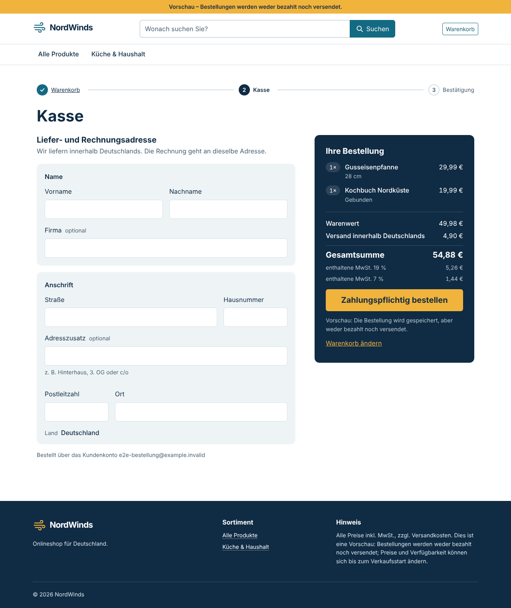
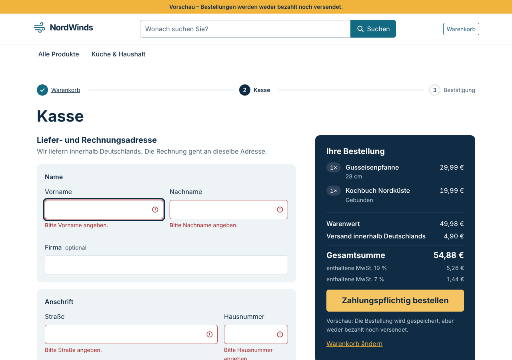
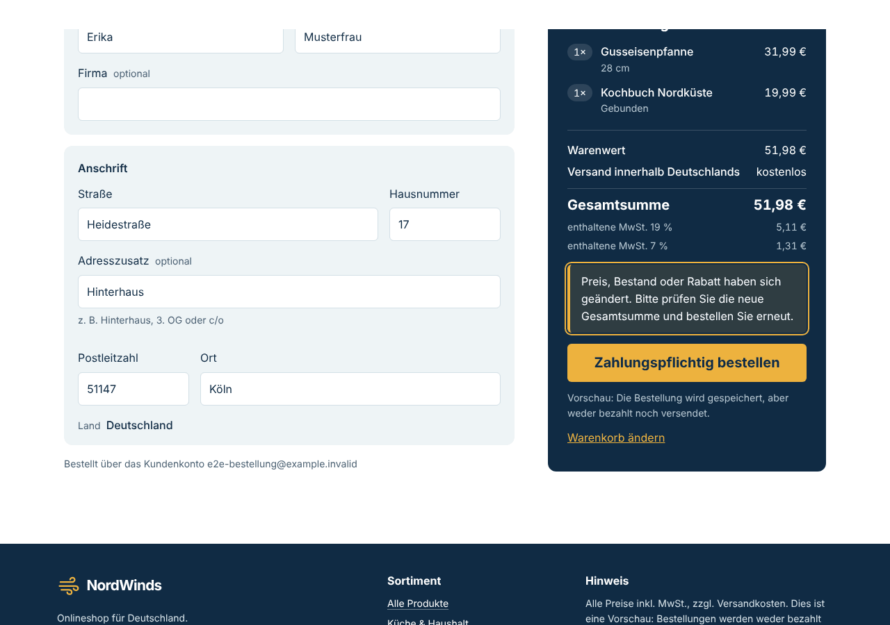
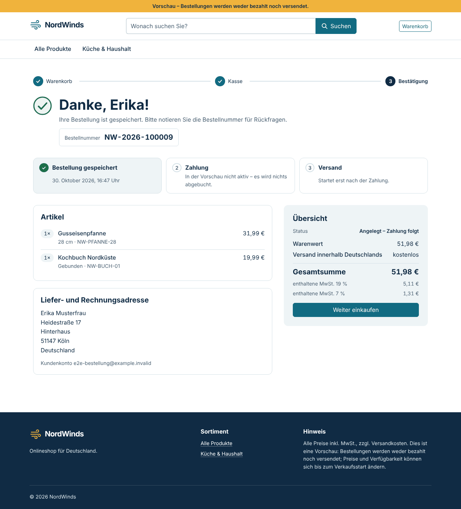
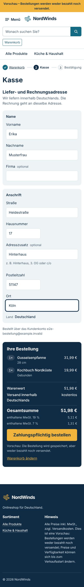
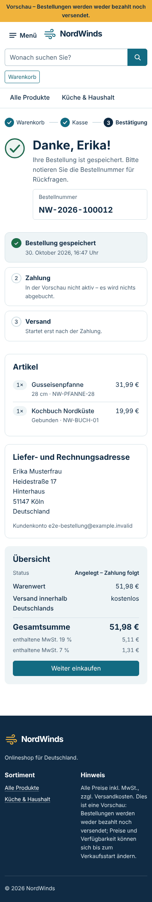

# NW-16 — Kasse und transaktionale Bestellanlage

- **Status:** Umgesetzt und geprüft.
  - Das Backend wurde mit Go 1.27.3 gegen PostgreSQL 16.15 getestet; das Projekt nutzt 18.6.
  - Die Oberfläche lief in derselben Linux-Ersatzumgebung wie in [NW-09](NW-09.md).
  - Offen sind `npm test` mit Vitest, der GitHub-Actions-Lauf und ein PostgreSQL-18-Lauf.
- **Basis:** `main` mit NW-15 (`9617e3c`). Anforderungen REQ-ORDER-01 und REQ-AUTH-01.
- **Entscheidung:** [ADR-008](../adr/ADR-008-order-creation.md). Der Projektinhaber hat am 30. Oktober 2026 festgelegt:
  - Ändert sich die Summe, antwortet die API mit 409 und zeigt die neue Übersicht.
  - Es gibt eine Adresse, nur in Deutschland.
  - Zur Aufgabe gehören API und Kasse.
  - Der Warenkorb wird in derselben Transaktion geleert.
- **Abgrenzung:** Bestand wird geprüft, aber nicht reserviert oder gebucht; das ist NW-17. Eine Zahlung gibt es erst mit NW-18. Die Kasse ist deshalb eine Vorschau: Bestellungen werden gespeichert, aber weder bezahlt noch versendet.

## API

**`POST /api/v1/orders`:**

- **Voraussetzungen:** Customer-Session, CSRF-Token und der Header `Idempotency-Key`.
- **Anfrage:** Adresse und `expected_total_cents`, die vor dem Klick angezeigte Gesamtsumme.
- **Ablauf in einer Transaktion:**
  1. Die Kundenzeile wird gesperrt.
  2. Ein bereits verwendeter Schlüssel wird geprüft.
  3. Der Warenkorb wird mit derselben Funktion wie die Warenkorbanzeige neu berechnet (`cart.Load`).
  4. Summe und Lieferbarkeit werden verglichen.
  5. Bestellung, Positionen und Statuseintrag `NULL → CREATED` werden angelegt; Warenkorb und Rabattcode werden geleert.

**Antworten:**

| Status | Code | Bedeutung |
| --- | --- | --- |
| 201 | — | Bestellung angelegt; `Location: /api/v1/orders/{orderNumber}` |
| 200 | — | Wiederholung mit demselben Schlüssel; dieselbe Bestellung, `Idempotent-Replayed: true` |
| 400 | `INVALID_REQUEST` | Schlüssel fehlt oder ist ungültig, Summe fehlt, unbekannte Felder |
| 409 | `CART_EMPTY` | Warenkorb leer |
| 409 | `CART_CHANGED` | `reason: total_changed` oder `item_unavailable`, mit aktuellem `cart` |
| 422 | `VALIDATION_FAILED` | `errors: [{field, code}]`, ohne die eingegebenen Werte |
| 422 | `IDEMPOTENCY_KEY_REUSED` | Schlüssel gehört zu einer anderen Adresse oder Summe |

**`GET /api/v1/orders/{orderNumber}`:** Liefert nur eigene Bestellungen; fremde und unbekannte Nummern ergeben 404.

**Migration 9 (`0009_orders`):**

- Neue Spalten an `orders`: Preisaufstellung, Steuerzeilen, Rabatt, E-Mail, Schlüssel und Fingerabdruck der Anfrage.
- Neue Spalten an `order_items`: Position, Variante, Positionssumme.
- Neue Tabelle `order_status_events` und Sequenz `order_number_seq`; Bestellnummern haben das Format `NW-2026-100001`.
- CHECKs für Summen, Unique-Index je Kunde und Schlüssel.
- Trigger:
  - Positionen und Statusverlauf sind nur anfügbar.
  - An Bestellungen dürfen sich nur Status (entlang ADR-008) und `updated_at` ändern.
  - Bestellungen lassen sich nicht löschen.
- Up verweigert Altbestellungen ohne Preisaufstellung, Down verweigert vorhandene Bestellungen.

**Vertrag:** Der [OpenAPI](../api/openapi.yaml)-Vertrag beschreibt Pfade, Header, Schemas und die neuen Problemfelder.

**Code:**

- `internal/orders`: Adressregeln, Statusübergänge, Repository mit Transaktion.
- `internal/server/orders.go`: HTTP-Schicht.
- `problem.go`: optionale Felder `errors`, `reason`, `cart` nach RFC 9457.
- `cart.Load` nimmt jetzt auch eine Transaktion an.

## Oberfläche

**Kasse (`/kasse`):**

- **Aufbau:**
  - Fortschrittsanzeige Warenkorb → Kasse → Bestätigung.
  - Links die Adresse in zwei Gruppen (Name, Anschrift), rechts die Bestellübersicht. Auf dem Desktop bleibt die Übersicht beim Scrollen stehen.
  - Die Übersicht ist eine Tiefsee-Fläche wie die Fußzeile. Sie zeigt Positionen, Warenwert, Rabatt, Versand, Gesamtsumme und MwSt. je Satz, direkt darunter den Bernstein-Knopf „Zahlungspflichtig bestellen“ (§ 312j BGB).
- **Prüfung im Browser:** Dieselben Regeln wie in der API. Fehlertexte stehen am Feld (`aria-invalid`, `aria-describedby`), der Fokus springt auf das erste fehlerhafte Feld. Feldfehler der API werden denselben Feldern zugeordnet.
- **Geänderter Warenkorb:** Bei 409 `CART_CHANGED` zeigt die Kasse die neue Summe aus der Antwort mit dem Hinweis „Bitte prüfen Sie die neue Gesamtsumme“. Erst ein weiterer Klick bestellt.
- **Idempotency-Key:** Ein Schlüssel je Besuch der Kasse (128 Bit aus `crypto.getRandomValues`). Er wird bei Wiederholungen nach Konflikt oder Netzabbruch wiederverwendet. Der Hinweis nach einem Abbruch sagt ehrlich, dass die Bestellung schon angelegt sein kann und ein erneuter Klick keine zweite anlegt.
- **Gesperrter Knopf:** solange eine Position nicht lieferbar ist oder eine Anfrage läuft.

**Bestätigung (`/bestellung/:orderNumber`):**

- Ein gezeichneter Haken, die einzige Animation; sie entfällt bei `prefers-reduced-motion`.
- „Danke, Erika!“, die Bestellnummer und „So geht es weiter“ in drei Schritten: gespeichert, Zahlung in der Vorschau nicht aktiv, Versand.
- Artikel, Adresse und Übersicht kommen aus dem gespeicherten Snapshot.
- 404 hat einen eigenen Zustand.

**Warenkorb:**

- Die Preisaufstellung ist jetzt die gemeinsame Komponente `app-price-summary`, die auch Kasse und Bestätigung nutzen.
- Neu ist der Knopf „Zur Kasse“; bei nicht lieferbaren Positionen steht stattdessen ein Hinweis.
- Anmeldung und Registrierung sind unverändert.

**Vorschauhinweise:** Die Texte in Leiste, Fußzeile, Produktdetail und Warenkorb lauten jetzt „Bestellungen werden weder bezahlt noch versendet“ statt „noch nicht möglich“.

## Prüfungen

| Prüfung | Ergebnis |
| --- | --- |
| `gofmt -l`, `go vet ./...`, `go build ./...` (Go 1.27.3) | **PASS** |
| `internal/orders` Unit-Tests: Adressregeln, alle 64 Statuspaare, Schlüssel- und Nummernformat, Fingerabdruck | **PASS** |
| `orders_integration_test.go` gegen PostgreSQL 16.15, 12 Abläufe | **PASS** |
| Gegentest: Kundensperre entfernt | Test **schlägt fehl** wie erwartet (500er und bis zu 3 Bestellungen statt 1); Sperre wiederhergestellt |
| Migrationstest Up/Down/Up mit Version 9, Datenverlust- und Altbestellungs-Sperre | **PASS** |
| `go test ./... -count=1` mit getrennten Datenbanken `nordwinds_test_*` | **PASS** für `server`, `orders`, `migrations`, `identity`, `database`, `pricing`; `internal/catalog` **FAIL** im bekannten NW-07-Test (PostgreSQL 16 meldet 23503 statt 23001, siehe [NW-10](NW-10.md)) |
| `go test -race ./internal/server/ ./internal/orders/` | **PASS** |
| `ng build` (production) | **PASS**; Kasse 16,3 kB und Bestätigung 10,8 kB als Lazy-Chunks; Initial 492,7 kB (vorher 481,2 kB) |
| `tsc` (App und Specs), `ng lint`, `npm run format:check` | **PASS** |
| Specs im Ersatz-Runner, Chromium und jsdom | **PASS**, jeweils 93 von 93 (13 neue für NW-16) |
| Ende-zu-Ende NW-16: echte Go-API, PostgreSQL 16.15, Angular-Build, Chromium | **PASS**, 15 von 15 (siehe unten) |
| Ende-zu-Ende NW-15 erneut (Warenkorb mit gemeinsamer Preisaufstellung) | **PASS**, 13 von 13 |
| `npm test` (Vitest) | **NICHT AUSGEFÜHRT**, wie NW-09 |
| `govulncheck ./...` | **NICHT AUSGEFÜHRT**, keine Verbindung zur Schwachstellen-Datenbank; neue Abhängigkeiten gibt es nicht |
| PostgreSQL 18.6 | **NICHT AUSGEFÜHRT**; der Docker-Stack führt Migration 9 beim nächsten `docker compose up --build -d` aus |

**Ende-zu-Ende im Detail:**

- Der Warenkorb führt über „Zur Kasse“ zur Kasse; dort ist Schritt 2 aktiv, und die Summe entspricht der API.
- Ein leeres Formular ergibt 6 Fehlertexte, den Fokus auf „Vorname“ und keine Bestellung.
- Preisänderung in der Datenbank nach dem Laden der Kasse: Hinweis, neue Summe 51,98 € wie in der API, keine Bestellung. Der zweite Klick bestellt.
- Die Bestätigung zeigt die gespeicherte Bestellung (Summe, Status `CREATED`, 2 Positionen, Ort laut Datenbank); der Warenkorb ist danach leer.
- Ein Doppelklick auf den Bestellknopf ergibt genau eine Bestellung.
- Derselbe Schlüssel über die API ergibt 201, dann 200 mit derselben Nummer und `Idempotent-Replayed: true`.
- Ein anderer Kunde erhält für die Bestellung 404 von der API und den Zustand „Bestellung nicht gefunden“.
- Telefon (390 px): Kasse und Bestätigung ohne horizontale Scrollleiste; Felder 48 px und Bestellknopf 55 px hoch.
- Jede Bestellung hat genau einen Statuseintrag `CREATED`.
- Keine Laufzeitfehler.

| Kasse | Fehlende Angaben | Geänderte Summe |
| --- | --- | --- |
|  |  |  |

| Bestätigung | Kasse, Telefon | Bestätigung, Telefon |
| --- | --- | --- |
|  |  |  |

## Lokal ausprobieren

```bash
docker compose up --build -d   # führt Migration 9 aus; vorhandene Volumes bleiben erhalten
```

Danach anmelden, Artikel in den Warenkorb legen, „Zur Kasse“ wählen und bestellen. Die Bestellung wird gespeichert, aber nicht bezahlt.

## Nächster Schritt

NW-17 (Bestandsreservierung und paralleler Kauf) baut auf `orders.Repository.Create` auf: Zeilensperre und atomare Buchung in derselben Transaktion.
