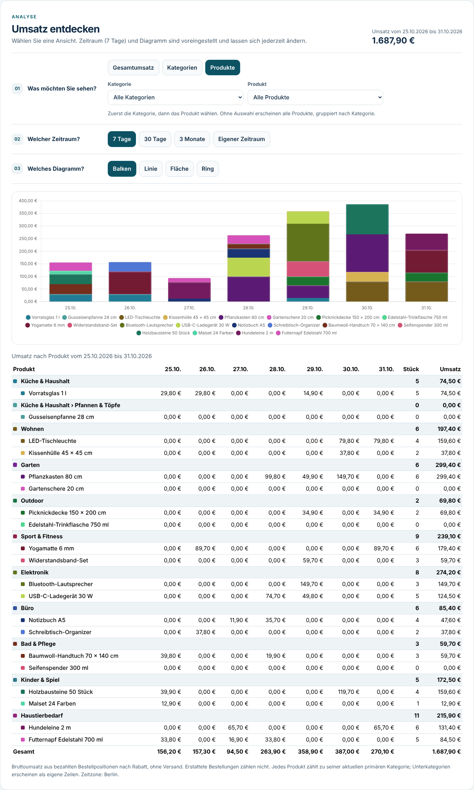
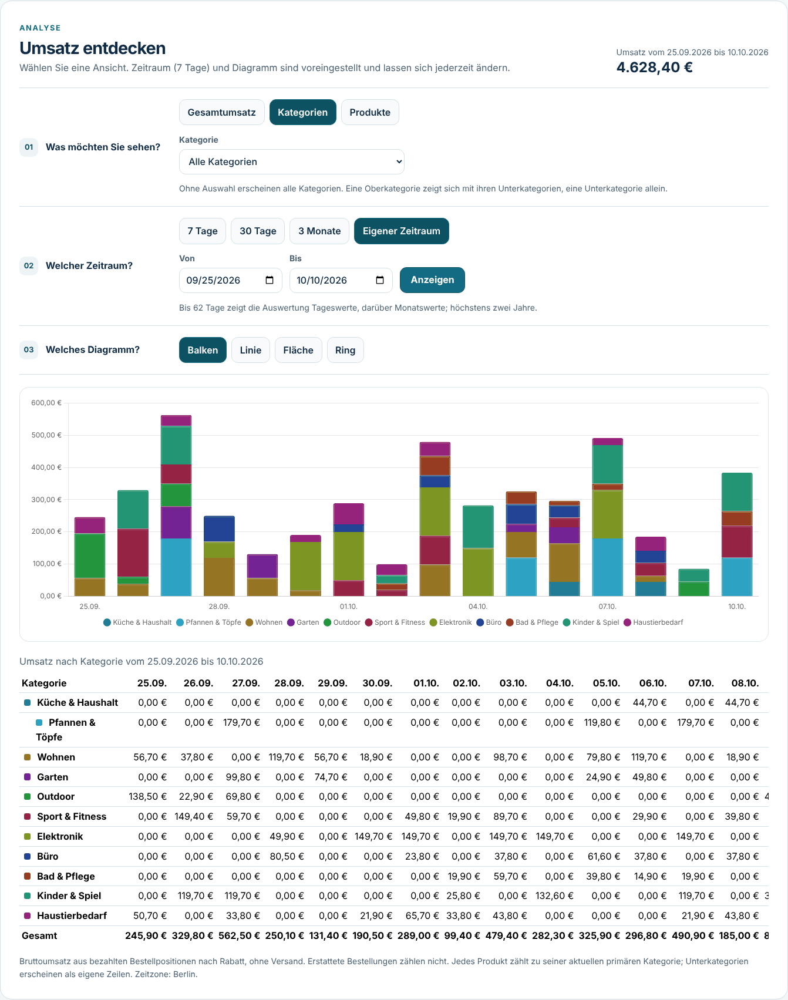
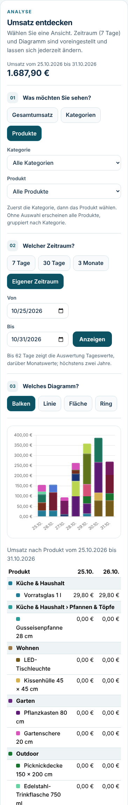

# NordWinds Admin Dashboard

Die Admin-Startseite zeigt sechs direkte Wege: Admin Dashboard, Kategoriebaum,
Produkte, Kategorie anlegen, Produkt anlegen und Rabattcodes. Bestellungen und
Versand bleiben über einen eigenen Link erreichbar. Mitarbeiter mit der Rolle
`employee` sehen weiterhin ausschließlich diesen Bestellbereich.

## Umsatzanalyse

Stand 31. Oktober 2026, überarbeitet nach Vorgabe des Projektinhabers: Unterauswahl für Kategorien, Produkte nach Kategorie, eigener Zeitraum, jede Kategorie und jedes Produkt einzeln, Farben nach Kategorie.

### Bedienung

1. **Ansicht:** Gesamtumsatz, Kategorien oder Produkte. Sobald eine Ansicht gewählt ist, lädt die Auswertung mit den Voreinstellungen.
   - **Kategorien:** Darunter erscheint eine Auswahlliste aller Kategorien der Datenbank als eingerückter Baum. Ohne Auswahl werden alle Kategorien gezeigt. Eine Oberkategorie zeigt sich mit allen Unterkategorien, eine Unterkategorie allein.
   - **Produkte:** Zuerst die Kategorie, dann das Produkt. Die Produktliste enthält nur Produkte der gewählten Kategorie samt Unterkategorien, nach Kategorie gruppiert; Entwürfe und archivierte Produkte sind gekennzeichnet. Ohne Auswahl werden alle Produkte gezeigt. Passt ein gewähltes Produkt nicht mehr zur neuen Kategorie, wird es abgewählt.
2. **Zeitraum:** 7 Tage (Voreinstellung), 30 Tage, drei Kalendermonate oder **Eigener Zeitraum** mit „Von“ und „Bis“.
   - Bis 62 Tage zeigt die Auswertung Tageswerte, darüber Monatswerte; höchstens 731 Tage, spätestens bis heute.
   - Ungültige Angaben werden vor dem Abruf mit einer Meldung abgefangen.
3. **Diagramm:** Balken (Voreinstellung), Linie, Fläche oder Ring.
   - Bei Kategorien und Produkten sind die Balken gestapelt: ein Balken je Tag, Farbbänder je Kategorie.
   - Der Tooltip blendet 0-€-Werte aus und nennt die Tagessumme.
   - Auf Telefonen entfällt bei mehr als zwölf Reihen die Legende; die Tabelle zeigt dieselben Farben.

Jede Kategorie bzw. jedes Produkt im gewählten Umfang erscheint als eigene Reihe, auch ohne Umsatz; die frühere Zusammenfassung unter „Weitere“ entfällt.

### Farben

Jede oberste Kategorie erhält einen eigenen Farbton. Die zwölf Töne liegen 30° auseinander und beginnen mit dem Fjord-Blau der Marke; ab der 13. Kategorie geht es im goldenen Winkel weiter.

- Unterkategorien sind hellere Töne ihrer Oberkategorie.
- Produkte sind Abstufungen ihrer Kategorie, von dunkel nach hell.
- Produkte ohne Kategorie sind grau.

Die Farben hängen nur von der Katalogreihenfolge ab und bleiben deshalb bei jedem Filter gleich.

### Tabelle

Die Tabelle enthält alle Werte des Diagramms und bleibt per Tastatur und Screenreader zugänglich; die Canvas-Grafik ist für Screenreader ausgeblendet.

- Bei Produkten gibt es eine Gruppenzeile je Kategorie mit Zwischensumme. Unterkategorien erscheinen als Pfad, z. B. „Küche & Haushalt › Pfannen & Töpfe“.
- Bei Kategorien sind Unterkategorien eingerückt.
- Die erste Spalte bleibt beim seitlichen Scrollen langer Zeiträume stehen.

Chart.js wird erst im Browser geladen (SSR).

### Berechnung

Der Umsatz umfasst Bruttobeträge der Bestellpositionen nach anteiligem Bestellrabatt, ohne Versandkosten. Maßgeblich ist das erste `PAID`-Ereignis einer weiterhin bezahlten, bearbeiteten, versandten oder zugestellten Bestellung in der Zeitzone `Europe/Berlin`. Erstattete Mock-Zahlungen werden ausgeschlossen.

Jedes Produkt zählt zu seiner **aktuellen** primären Kategorie (erste Zuordnung nach `sort_order` und ID). Eine Kategorie zählt nur Produkte, deren primäre Kategorie sie ist; Unterkategorien sind eigene Reihen. So entsteht keine Doppelzählung, und die Summe aller Reihen ist der Gesamtumsatz. Spätere Katalogänderungen können historische Zuordnungen und Namen in der Analyse ändern.

### API

`GET /api/v1/admin/analytics/sales` und `GET /api/v1/admin/analytics/catalog` erfordern die Rolle `admin` und antworten mit `Cache-Control: no-store`.

| Parameter | Bedeutung |
| --- | --- |
| `group_by` | `total`, `category` oder `product` |
| `period` | `week`, `month`, `quarter` oder `custom` |
| `from`, `to` | nur bei `custom`, jeweils einschließlich (`YYYY-MM-DD`) |
| `category_id` | Kategorie samt Unterkategorien |
| `product_id` | ein Produkt; nicht bei `category`, mit `category_id` nur innerhalb dieser Kategorie |

- **Fehler:** 400 bei ungültigen Werten, 404 für eine unbekannte Kategorie oder ein unbekanntes Produkt.
- **Reihen:** Jede Reihe enthält `category_key`, `category_label`, `depth` und bei Unterkategorien `parent_key`.
- **Katalog:** `/catalog` liefert die Kategorien in Baumreihenfolge mit Tiefe und die Produkte mit primärer Kategorie für die Auswahllisten.
- **Vertrag:** [OpenAPI](../api/openapi.yaml).

Bei sehr großen Katalogen werden alle Produkte einzeln gezeigt. Für einen Überblick empfiehlt sich dann der Kategoriefilter.

## Ansichten

Synthetische Daten: Demokatalog mit 10 Kategorien und einer Unterkategorie, 20 Produkten und 191 bezahlten Testbestellungen.

| Ansicht | Bild |
| --- | --- |
| Produkte nach Kategorie, 7 Tage, gestapelte Balken |  |
| Kategorien mit eigenem Zeitraum |  |
| Telefon (390 px) |  |

## Prüfung

- **PostgreSQL-Integration** (`NORDWINDS_ANALYTICS_TEST_URL`):
  - Zugriff nur für Admins; nicht angemeldete Personen, Kunden und Mitarbeiter abgelehnt.
  - Zeitraum-Buckets und centgenaue Rabattverteilung; Erstattungen zählen nicht.
  - Kategorien in Baumreihenfolge, einschließlich Unterkategorie, Kategorie ohne Umsatz und „Ohne Kategorie“.
  - Filter auf Oberkategorie (mit Unterkategorie) und auf Unterkategorie (allein).
  - Produkte gruppiert nach Kategorie, darunter ein Entwurf und ein Produkt ohne Kategorie.
  - Produkt- und Kategoriefilter; Gesamtumsatz einer Kategorie.
  - Eigener Zeitraum, auch ohne Verkäufe.
  - 400 für ungültige Angaben (Zukunft, fehlendes Datum, Datum ohne `custom`, keine UUID, Produkt bei Kategorien, Produkt außerhalb der Kategorie); 404 für unbekannte IDs.
  - `/catalog`: Inhalt und Zugriffsschutz.
- **Go-Unittests:** Zeiträume über die Zeitumstellung und den Jahreswechsel, Monatsansicht ab 63 Tagen, ungültige Zeiträume, Unterkategorien über mehrere Ebenen.
- **Angular-Komponententests:**
  - Voreinstellung 7 Tage mit sofortigem Balkendiagramm.
  - Kategorienauswahl als Baum; alle, Oberkategorie, Unterkategorie.
  - Produkte erst nach Kategorie, dann einzeln; Gruppenzeilen mit Zwischensumme; nicht passendes Produkt abgewählt.
  - Eigener Zeitraum mit Abruf, Fehler bei vertauschtem Datum und bei mehr als zwei Jahren.
  - Farben je Kategorie, Abstufungen je Produkt, stabil bei Filtern.
  - Gestapelte Balken, Tooltip-Filter, Legende auf schmalen Bildschirmen.
- **Sichtprüfung:** Produktionsbuild gegen die echte API in Chromium bei 1366 px und 390 px, ohne Konsolenfehler und ohne horizontalen Seitenüberlauf.
