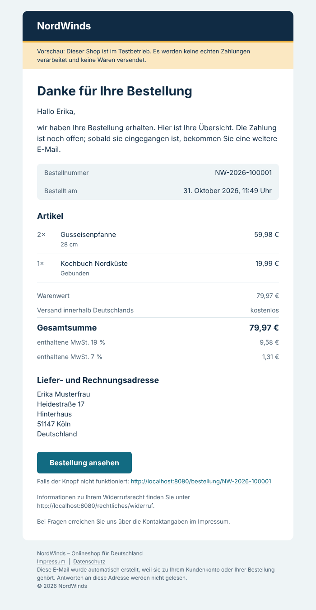
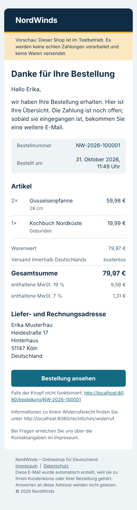
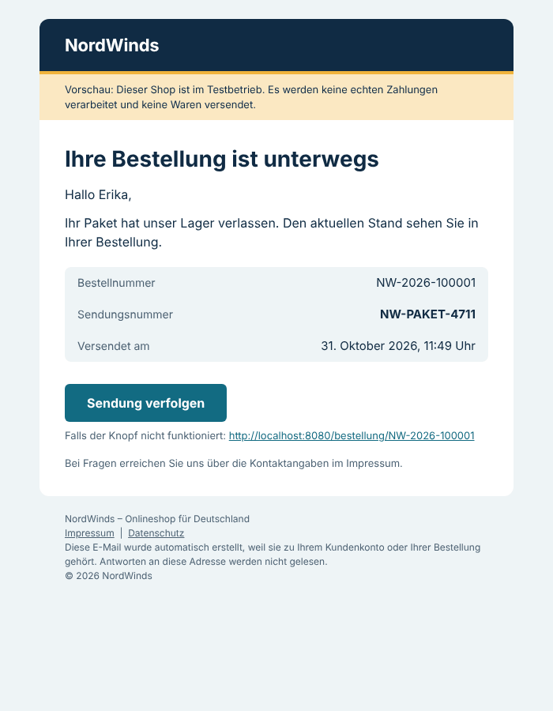
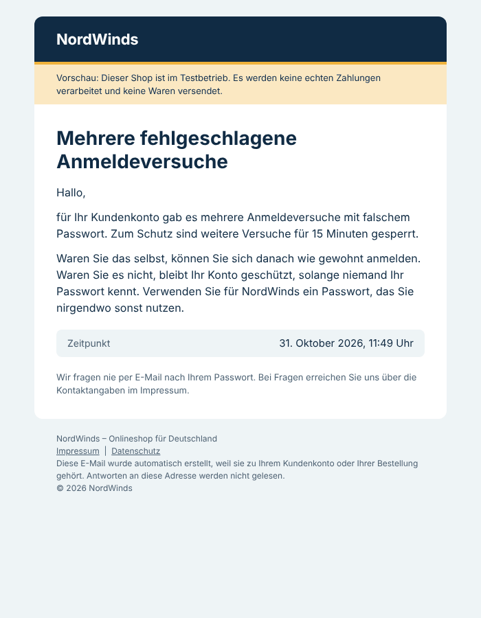

# E-Mail-Benachrichtigungen mit Mailpit

- **Stand:** 31. Oktober 2026. Umgesetzt und geprüft gegen PostgreSQL 16.15 (das Projekt nutzt 18.6) mit Go 1.27.3.
- **Basis:** `main` mit NW-16 bis NW-25 und Mitarbeiterrolle (`479cad4`).
- **Entscheidung:** [ADR-011](../adr/ADR-011-e-mail-benachrichtigungen.md).
- **Vorgaben des Projektinhabers:**
  - Nur Ereignisse, die es im Projekt gibt.
  - Mailpit statt MailHog.
  - Nur eigene Änderungen mergen.
- **Offen:** Ein Lauf mit Docker Compose und der echten Mailpit-Oberfläche steht aus (siehe Prüfungen).

## Was der Kunde bekommt

| E-Mail | Auslöser |
| --- | --- |
| Willkommen bei NordWinds | Registrierung |
| Sicherheitshinweis: mehrere fehlgeschlagene Anmeldeversuche | 6. falsches Passwort in 15 Minuten, einmal je Sperrfenster |
| Ihr Kundenkonto wurde geschlossen | Kontoschließung, an die bisherige Adresse |
| Bestellbestätigung NW-… | Bestellung angelegt: Positionen, Summen, MwSt., Adresse, Widerrufshinweis |
| Zahlung erhalten | Zahlung erfolgreich (Webhook) |
| Zahlung fehlgeschlagen | Zahlung fehlgeschlagen |
| Ihre Bestellung wird vorbereitet | Status `PROCESSING` |
| Ihre Bestellung ist unterwegs | Status `SHIPPED` mit Sendungsnummer |
| Ihre Bestellung wurde zugestellt | Status `DELIVERED` |
| Bestellung storniert | Kunde, Zahlungsfrist oder Admin; der Text nennt den Grund |
| Erstattung für Bestellung NW-… | Erstattung der Zahlung |

| Bestellbestätigung | Telefon | Versand | Sicherheitshinweis |
| --- | --- | --- | --- |
|  |  |  |  |

Die Bilder sind die HTML-Fassungen echter, von der laufenden API versendeter E-Mails, in Chromium dargestellt.

## Geänderte und neue Dateien

**Neu:**

- `backend/internal/migrations/sql/0015_notifications.{up,down}.sql`: Outbox und Trigger.
- `backend/internal/notification/`:
  - `config.go`: Umgebung und Schutzregeln;
  - `smtp.go`: SMTP mit STARTTLS, TLS und AUTH sowie Fehlerkategorien;
  - `message.go`: MIME;
  - `content.go`: deutsche Texte;
  - `render.go` und `templates/`: HTML- und Textlayout;
  - `outbox.go` und `dispatcher.go`: Abholen, Versand, Backoff.
- `backend/internal/notification/smtptest/`: SMTP-Testserver wie `httptest`.
- `backend/internal/server/admin_notifications.go`: Admin-API.
- Tests:
  - `backend/internal/notification/*_test.go`;
  - `backend/internal/server/notifications_integration_test.go`.
- `docs/adr/ADR-011-e-mail-benachrichtigungen.md`, dieses Dokument und Bilder in `e-mail/`.

**Geändert:**

- `backend/internal/notification/smtp.go`: Der bisherige MailHog-Versand ist durch den neuen Transport ersetzt.
- `backend/cmd/api/main.go`: Konfiguration, Dispatcher und Admin-Routen. Die direkte Begrüßung beim Registrieren entfällt.
- `backend/internal/identity/service.go`: optionaler Sicherheitshinweis beim ersten gesperrten Versuch.
- `backend/internal/migrations/migrate.go` und `migrate_integration_test.go`: Version 15.
- `compose.yaml`, `.env.example`, `.env.staging.example`: Mailpit und SMTP-Variablen.
- `README.md`, `backend/README.md`, `docs/api/openapi.yaml`.
- Nicht geändert: Registrierungsformular, Frontend, Bestell-, Zahlungs- und Versandcode.

## Lokal starten und testen

```bash
cp .env.example .env            # falls noch nicht vorhanden; enthält MAIL_TRANSPORT=smtp und SMTP_HOST=mailpit
docker compose up --build -d    # führt Migration 15 aus; vorhandene Volumes bleiben erhalten
```

- **Shop:** `http://127.0.0.1:8080`.
- **Mailpit:** `http://127.0.0.1:8025`. Alle E-Mails landen dort, nichts geht an echte Postfächer.

| Szenario | So auslösen |
| --- | --- |
| Begrüßung | Im Warenkorb ein Konto erstellen |
| Sicherheitshinweis | Sechsmal mit falschem Passwort anmelden |
| Bestellbestätigung | Mit `NORDWINDS_DEMO_CHECKOUT_ENABLED=true` in `.env` bestellen |
| Zahlung erhalten / fehlgeschlagen | Auf der Bestellseite eine simulierte Zahlungsart wählen und „Erfolg“ bzw. „Fehlschlag“ simulieren |
| Bearbeitung, Versand, Zustellung | Unter `/admin/bestellungen` den Status setzen; bei Versand mit Sendungsnummer |
| Stornierung | Eine offene Bestellung auf ihrer Seite stornieren |
| Erstattung | Nach erfolgreicher Zahlung die Erstattung simulieren |
| Kontoschließung | Im Kundenkonto das Konto schließen (ohne offene Bestellungen) |
| Fehler und Wiederholung | `docker compose stop mailpit`, bestellen, wieder starten. Die E-Mail kommt nach Ablauf des Backoffs (1 Minute). `GET /api/v1/admin/notifications` zeigt den Zwischenstand. |

Automatisch:

```bash
cd backend
go test ./internal/notification/...    # ohne Datenbank: Konfiguration, MIME, Vorlagen, SMTP
# mit zwei leeren Testdatenbanken nordwinds_test_*:
NORDWINDS_NOTIFICATION_TEST_URL=… NORDWINDS_NOTIFICATION_FLOW_TEST_URL=… go test ./internal/notification/... ./internal/server/
```

## Wechsel zu einem echten SMTP-Anbieter

1. **Anbieter wählen:** Server in der EU und Vertrag zur Auftragsverarbeitung (Art. 28 DSGVO).
2. **Absenderdomain einrichten:**
   - SPF-Eintrag des Anbieters;
   - DKIM-Schlüssel;
   - DMARC (zunächst `p=none` mit Berichten, danach `quarantine`/`reject`);
   - Reverse-DNS beim Anbieter.
3. **Umgebung setzen** (Passwort nur als Secret-Datei):

   ```
   APP_ENV=production
   MAIL_TRANSPORT=smtp
   SMTP_HOST=smtp.anbieter.example
   SMTP_PORT=587
   SMTP_TLS=starttls
   SMTP_USERNAME=…
   SMTP_PASSWORD_FILE=/run/secrets/smtp_password
   MAIL_FROM=NordWinds <no-reply@ihre-domain.de>
   MAIL_REPLY_TO=service@ihre-domain.de
   ```

4. **Mailpit entfernen:** Den Dienst `mailpit` nicht mitstarten bzw. in der Produktions-Compose-Datei weglassen. Seine Oberfläche nie öffentlich veröffentlichen.
5. **Start prüfen:** Die API verweigert den Start mit Testpostfach, Klartext, fehlenden Zugangsdaten oder Testdomain. Das Protokoll meldet `notification.started` mit Host und TLS-Modus, ohne Zugangsdaten.
6. **Überwachen:** `GET /api/v1/admin/notifications` (`counts.failed`, `counts.pending`) und die Protokollereignisse `notification.delivery`.

## Prüfungen

| Prüfung | Ergebnis |
| --- | --- |
| `gofmt -l`, `gofmt -s -l`, `go vet ./...`, `go build ./...` | **PASS** |
| `internal/notification` ohne Datenbank: 14 Tests mit Untertests (Konfiguration und Produktionsschutz, MIME und Header Injection, alle 11 Vorlagen, Maskierung, deutsche Beträge und Zeiten, SMTP mit STARTTLS, implizitem TLS, AUTH, falschem Passwort, unbekannter CA, fehlendem STARTTLS, 550/451, geschlossenem Port, Zeitüberschreitung) | **PASS** |
| `TestOutboxOnPostgres`, 7 Abläufe (Trigger, Doppel-Schutz, CHECKs, Backoff 1 min bis 6 h und Abbruch nach 6 Versuchen, dauerhafter Fehler, Retry, parallele Abholer ohne Überschneidung, Absturz und Reservierungsablauf, Reihenfolge, geschlossene Konten, Sicherheitshinweis je Fenster, Admin-Sicht) | **PASS** |
| `TestNotificationFlowOnPostgres`, 7 Abläufe über echte HTTP-Endpunkte und SMTP (Registrierung, Sperre mit gleicher Antwort für unbekannte Adressen, Bestellung, Zahlung, doppelter Webhook ohne zweite E-Mail, Bearbeitung, Versand mit Sendungsnummer, Zustellung, Erstattung, Fehlschlag, Stornierung ohne Doppelung, Mailausfall ohne Wirkung auf die Bestellung samt Nachholen, Admin-API mit Rolle und CSRF, Kontoschließung) | **PASS** |
| Migrationstest Up/Down/Up mit Version 15 und Datenverlustsperre | **PASS** |
| `go test ./... -count=1` mit getrennten Datenbanken `nordwinds_test_*` | **PASS** außer dem bekannten NW-07-Test in `internal/catalog` (PostgreSQL 16 meldet 23503 statt 23001, siehe [NW-10](NW-10.md)) |
| `go test -race ./internal/notification/... ./internal/server/` | **PASS** |
| Ende-zu-Ende mit echter API-Binärdatei, PostgreSQL und einem lokalen SMTP-Empfänger (8 Prüfungen: Begrüßung, Sperre, Bestellung, fünf Folge-E-Mails in richtiger Reihenfolge, Sendungsnummer, Admin-Zählung, keine gespeicherten Adressen) | **PASS** |
| Darstellung der echten HTML-E-Mails in Chromium bei 700 und 390 px | **PASS**, kein horizontales Scrollen |
| `docker compose config` und Lauf mit Mailpit-Oberfläche | **NICHT AUSGEFÜHRT**: In der Cloud-Umgebung gibt es kein Docker, und das Ausführen der heruntergeladenen Mailpit-Binärdatei war gesperrt. Bitte lokal `docker compose up --build -d` und `http://127.0.0.1:8025` prüfen. |
| PostgreSQL 18.6, `govulncheck` | **NICHT AUSGEFÜHRT**; neue Go-Abhängigkeiten gibt es nicht (nur Standardbibliothek) |
| Darstellung in Outlook, Gmail und Apple Mail | **NICHT AUSGEFÜHRT**; das Layout folgt den üblichen Regeln (Tabellen, Inline-Styles, keine Bilder) |

## Nicht umgesetzt (kein Ablauf im Projekt)

- **Konto:** E-Mail-Verifizierung, Passwort vergessen/geändert, E-Mail-Änderung, Zwei-Faktor-Authentifizierung, Anmeldung von neuem Gerät.
- **Bestellung:** Rücksendung, Rechnung.
- **Weitere Benachrichtigungen:** wieder vorrätig, Supportantwort, Benachrichtigungseinstellungen, Newsletter.

ADR-011 beschreibt, wie jede davon später ergänzt wird.
